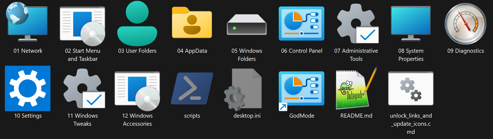

# CTRL-WIN

**262 Windows shortcuts in 12 categories, with familiar English names and native Windows icons.**

CTRL-WIN brings system folders, classic Control Panel dialogs, administrative tools, Settings pages, diagnostics, and everyday Windows apps into one portable Explorer folder. Setup uses the **Videos** folder template and **Extra large icons (256 pixels)** so the collection is easy to browse.

*Actual Explorer screenshot, supplied by the project owner. Hidden files are enabled in this view. Icon artwork and the Windows interface language depend on the local installation; collection labels and documentation are English.*

## Get started

1. Download and extract [CTRL-WIN 0.1.0-alpha.1](https://github.com/Paule89DE/CTRL-WIN/releases/tag/v0.1.0-alpha.1).
2. Double-click **`unlock_links_and_update_icons.cmd`** from the extracted folder.
3. Open a numbered category and launch the Windows shortcut you need.

Run setup again after moving the collection or copying it to another PC. Setup needs a writable local collection folder and the built-in Windows PowerShell 5.1. Individual tools may request administrator rights. The optional tweaks are applied only when explicitly opened.

## Documentation

| Document | What it explains |
| --- | --- |
| [Usage and categories](docs/USAGE.md) | Installation, each folder's purpose, common tasks, Windows compatibility, and download prompts |
| [Shortcut catalog](docs/CATALOG.md) | All 262 shortcuts with their individual purpose and launch target |
| [Optional tweaks](docs/TWEAKS.md) | All 17 REG/CMD files, effects, scope, rights, preview mode, and reversal behavior |
| [Setup and maintenance](docs/MAINTENANCE.md) | Each helper, native icons, Videos templates, saved views, portable targets, troubleshooting, and validation |
| [Changelog](CHANGELOG.md) | Version history and the changes included in this alpha |

## Categories

| Folder | Contents |
| --- | --- |
| 01 Network | Network Connections, Network and Sharing Center, shares, network shortcuts, Quick Access, and credentials |
| 02 Start Menu and Taskbar | Start Menu, Programs, Startup, pinned shortcuts, Quick Launch, and WinX |
| 03 User Folders | Desktop, Documents, Downloads, Pictures, Music, Videos, Libraries, and public folders |
| 04 AppData | Local, LocalLow, Roaming, SendTo, Recent, jump lists, caches, and app data |
| 05 Windows Folders | System32, SysWOW64, ProgramData, Program Files, Drivers, logs, and Windows caches |
| 06 Control Panel | Classic Control Panel pages and CPL applets |
| 07 Administrative Tools | Computer Management, Task Scheduler, Services, Device Manager, Event Viewer, certificates, and policies |
| 08 System Properties | Advanced system properties, performance, protection, hardware, environment variables, and user accounts |
| 09 Diagnostics | Task Manager, System Information, Resource Monitor, Reliability Monitor, Disk Cleanup, and recovery tools |
| 10 Settings | Direct links to Windows Settings, organized by topic |
| 11 Windows Tweaks | Optional REG and CMD files, with reversal files where applicable |
| 12 Windows Accessories | Remote Desktop Connection, Calculator, Notepad, Paint, Snipping Tool, Character Map, On-Screen Keyboard, Magnifier, Narrator, Command Prompt, Windows PowerShell, and About Windows |

The root **GodMode** shortcut opens All Tasks, the combined classic Control Panel task list.

## What setup changes

Setup removes download markers from `.lnk` and `desktop.ini` files, refreshes shortcut and folder icons using installed Windows resources, restores folder customization attributes, and saves the collection's folder views for the current user. The collection has 30 customized folders; documentation and screenshots add two more. Junctions, symbolic links, and `.git` are skipped.

Setup does not apply the optional tweaks. Their permanent Registry, network, clock, and execution-policy changes are documented separately in [TWEAKS.md](docs/TWEAKS.md). Reset files remove or replace specified values; they are not a backup of a previous custom configuration.

## Compatibility and alpha status

The collection targets Windows 10 and Windows 11. Some tools need particular editions, hardware, drivers, apps, or installed components. Windows can redirect older dialogs to modern Settings. The collection opens existing Windows features; it does not install missing components. Names remain short, with full explanations in the catalog.

Version **0.1.0-alpha.1** is the first published alpha. See the [release notes](CHANGELOG.md) and [validation details](docs/MAINTENANCE.md#release-and-validation) for the checks performed and their limits.
